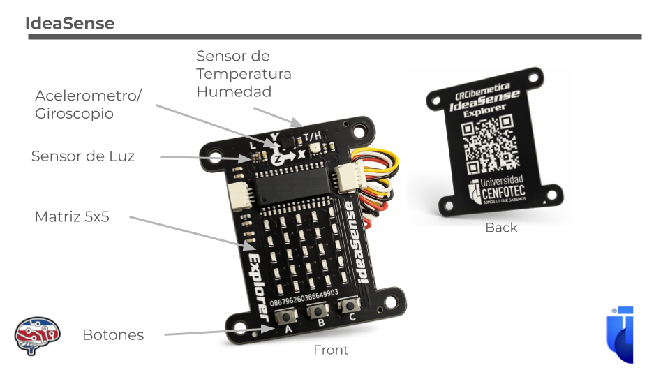

# IdeaSense

Ejemplos, librerías y material educativo para programar la **IdeaBoard** con la tarjeta de sensores **IdeaSense Explorer** en CircuitPython.

Desarrollado en la **Universidad CENFOTEC** por el **Dr. Tomás de Camino Beck**, en conjunto con **[CRCibernética](https://www.crcibernetica.com/)**, con aportes de estudiantes y colaboradores (ver [Créditos](#créditos)).

<p align="center">
  
</p>

🌐 **Portal de herramientas:** <https://universidad-cenfotec.github.io/IdeaSense/>

---

## Contenido

- [¿Qué es IdeaSense?](#qué-es-ideasense)
- [Plataformas de programación](#plataformas-de-programación)
- [Primeros pasos](#primeros-pasos)
- [Referencia rápida de la API](#referencia-rápida-de-la-api)
- [Estructura del repositorio](#estructura-del-repositorio)
- [Catálogo de ejemplos](#catálogo-de-ejemplos)
- [Proyectos de inteligencia artificial](#proyectos-de-inteligencia-artificial)
- [Comparación con micro:bit](#comparación-con-microbit)
- [Recursos](#recursos)
- [Créditos](#créditos)

---

## ¿Qué es IdeaSense?

La **[IdeaSense Explorer](https://www.crcibernetica.com/crcibernetica-ideasense-explorer/)** es una tarjeta educativa de expansión diseñada por CRCibernética (Costa Rica) y Universidad CEFNFOTEC que se conecta a la **[IdeaBoard](https://www.crcibernetica.com/crcibernetica-ideaboard)** (ESP32 con Wi‑Fi y Bluetooth LE) por el conector I²C STEMMA QT / QWIIC. La IdeaBoard ejecuta el programa; la IdeaSense aporta pantalla, botones y sensores.

| Componente | Chip | Dirección I²C | En Python |
| :--- | :--- | :---: | :--- |
| Matriz LED 5×5 y botones A, B, C | HT16K33 | `0x70` | `idea.matrix`, `idea.events`, `idea.pressed`, `idea.held` |
| Temperatura y humedad | SHT30 | `0x44` | `idea.temp` (°C), `idea.humid` (%) |
| Luz ambiental (visible + IR) | LTR‑303 | `0x29` | `idea.light` (cuentas) |
| Acelerómetro y giroscopio (6 ejes) | LSM6DS3TR‑C | `0x6A` | `idea.accel` (m/s²), `idea.gyro` (rad/s) |

Además tiene **dos conectores QWIIC** para agregar más sensores sin soldar. De la IdeaBoard se usan con frecuencia el LED RGB (`ib.pixel`), los motores (`ib.motor_1`, `ib.motor_2`), los pines analógicos y táctiles, y el Bluetooth.

---

## Plataformas de programación

Todas funcionan en el navegador (Chrome o Edge) y no requieren instalar nada.

| Herramienta | Para qué sirve | Enlace |
| :--- | :--- | :--- |
| 🧩 **IdeaScratch** | Programación por bloques, estilo Scratch. Ideal para empezar. | <https://ideascratch.crcibernetica.com/> |
| 🐍 **IdeaCode** | Editor de CircuitPython (inspirado en Thonny) con consola. Es la forma recomendada de usar los ejemplos de este repositorio. | <https://ideacode.crcibernetica.com/> |
| 🧠 **IdeaAI** | Grabar gestos con el IMU, entrenar un clasificador y exportarlo como `code.py`. | <https://ideaai.crcibernetica.com/> |
| 🔬 **IdeaSense Ciencias** | Laboratorio de sensores en vivo con gráficos y descarga CSV. | <https://universidad-cenfotec.github.io/IdeaSense/ideaciencia/> |
| 📷 **Teachable IdeaSense** | Modelo de imágenes de Teachable Machine en el navegador que envía la clase detectada por Bluetooth. | <https://universidad-cenfotec.github.io/Libro-de-la-IA/teachable-ideasense/index.html> |

El portal [universidad-cenfotec.github.io/IdeaSense](https://universidad-cenfotec.github.io/IdeaSense/) (carpeta [`docs/`](docs/)) reúne todas estas herramientas.

---

## Primeros pasos

1. **Conecta** la IdeaSense Explorer a la IdeaBoard y la IdeaBoard a la computadora con un cable USB‑C de datos.
2. **Abre [IdeaCode](https://ideacode.crcibernetica.com/)** en Chrome o Edge y presiona *Connect*. La IdeaBoard **no aparece como unidad USB** (no hay carpeta `CIRCUITPY`); los archivos se pasan por el puerto serie desde IdeaCode o Thonny.
3. **Copia un ejemplo** de la carpeta [`ejemplos/`](ejemplos/) y pégalo en el editor.
4. **Ejecuta** con `Ctrl+R`. Lo que imprime `print()` aparece en la consola; `Ctrl+C` detiene el programa.
5. Para que el programa arranque solo al encender la tarjeta, **guárdalo como `code.py`** en la raíz de la tarjeta.

**Librerías.** La IdeaBoard viene de fábrica con `ideaboard.py`, `ideasense.py` y las librerías de Adafruit necesarias en `/lib`. Algunos ejemplos usan además librerías propias de este repositorio, que hay que copiar a `/lib` en la tarjeta:

| Librería | Usada por |
| :--- | :--- |
| [`lib/statemachine.py`](lib/statemachine.py) | Teachable IdeaSense y SumoIA |
| [`MultiLayerPerceptron/mlp.py`](MultiLayerPerceptron/mlp.py) | Ejemplos de perceptrón multicapa |

Más detalles en [`lib/README.md`](lib/README.md).

---

## Referencia rápida de la API

```python
import time
from ideaboard import IdeaBoard
from ideasense import IdeaSense

ib = IdeaBoard()        # LED RGB, motores, pines de la IdeaBoard
idea = IdeaSense()      # matriz, botones y sensores de la IdeaSense

# Matriz 5x5: (x, y) de 0 a 4, (0, 0) arriba a la izquierda
idea.matrix.fill(0)
idea.matrix[2, 2] = 1
idea.matrix.brightness(0.3)   # es un método: no usar "= 0.3"
idea.matrix.show()

# Sensores
t = idea.temp                 # °C
h = idea.humid                # % humedad relativa
luz = idea.light              # cuentas (más alto = más luz)
ax, ay, az = idea.accel       # m/s² (quieta y plana: un eje ≈ ±9.8)
gx, gy, gz = idea.gyro        # rad/s

# Botones: A = 0, B = 1, C = 2
while True:
    evento = idea.events.get()        # cola de eventos (recomendado)
    if evento and evento.pressed and evento.key_number == 0:
        ib.pixel = (0, 255, 0)        # LED RGB en verde
    time.sleep(0.02)
```

También existen `idea.pressed`, `idea.released` e `idea.held` (listas `[A, B, C]`). La referencia completa está en [`lib/README.md`](lib/README.md).

---

## Estructura del repositorio

```text
IdeaSense/
├── README.md                     ← este archivo
├── CONTRIBUTING.md               ← cómo agregar ejemplos
├── lib/                          ← librerías para copiar a /lib en la tarjeta
│   ├── ideasense.py              (copia de la librería oficial de CRCibernética)
│   └── statemachine.py           (máquina de estados para BLE e IA)
├── ejemplos/                     ← programas cortos, ordenados por tema
│   ├── 01_matriz_y_botones/
│   ├── 02_sensores_ambientales/
│   ├── 03_movimiento/
│   ├── 04_pines_ideaboard/
│   └── 05_sistemas_y_evolucion/
├── IdeaAI_Ejemplos/              ← modelos de gestos exportados desde IdeaAI
├── MultiLayerPerceptron/         ← red neuronal que se entrena en la propia tarjeta
├── Techable_Ideasense/           ← visión artificial (Teachable Machine) + BLE
│   └── SumoIA/                   ← Sumobot controlado por IA
├── docs/                         ← sitio web (GitHub Pages)
│   └── ideaciencia/              ← IdeaSense Ciencias
└── images/
```

---

## Catálogo de ejemplos

Cada archivo empieza con un encabezado que explica qué hace, qué controles usa y quién lo escribió. Cada carpeta tiene su propio `README.md`.

### [01 · Matriz y botones](ejemplos/01_matriz_y_botones/)

| Ejemplo | Descripción |
| :--- | :--- |
| [`botones_letras.py`](ejemplos/01_matriz_y_botones/botones_letras.py) | Muestra A, B o C según el botón presionado. |
| [`space_invaders.py`](ejemplos/01_matriz_y_botones/space_invaders.py) | Íconos 5×5 estilo Space Invaders; también funciona como módulo. |
| [`tetris.py`](ejemplos/01_matriz_y_botones/tetris.py) | Mini Tetris en 5×5. |

### [02 · Sensores ambientales](ejemplos/02_sensores_ambientales/)

| Ejemplo | Descripción |
| :--- | :--- |
| [`medidor_luz.py`](ejemplos/02_sensores_ambientales/medidor_luz.py) | Nivel de luz en la matriz y alerta amarilla. |
| [`temp_bargraph.py`](ejemplos/02_sensores_ambientales/temp_bargraph.py) | Gráfico de barras de temperatura en el tiempo. |
| [`temp_scrolling.py`](ejemplos/02_sensores_ambientales/temp_scrolling.py) | Temperatura como texto desplazable. |

### [03 · Movimiento (acelerómetro)](ejemplos/03_movimiento/)

| Ejemplo | Descripción |
| :--- | :--- |
| [`flechas_acelerometro.py`](ejemplos/03_movimiento/flechas_acelerometro.py) | Flecha hacia el lado de la inclinación. |
| [`gota.py`](ejemplos/03_movimiento/gota.py) | Una gota que rueda según la inclinación. |
| [`inclinacion.py`](ejemplos/03_movimiento/inclinacion.py) | Nivel de burbuja con calibración. |

### [04 · Pines de la IdeaBoard](ejemplos/04_pines_ideaboard/)

| Ejemplo | Descripción |
| :--- | :--- |
| [`perilla.py`](ejemplos/04_pines_ideaboard/perilla.py) | Potenciómetro en IO33 que llena la matriz. |
| [`tactil.py`](ejemplos/04_pines_ideaboard/tactil.py) | Sensor táctil capacitivo en IO4. |
| [`mascota.py`](ejemplos/04_pines_ideaboard/mascota.py) | Mascota virtual que despierta al tocarla. |

### [05 · Sistemas y evolución](ejemplos/05_sistemas_y_evolucion/)

| Ejemplo | Descripción |
| :--- | :--- |
| [`ashby.py`](ejemplos/05_sistemas_y_evolucion/ashby.py) | Máquina de estados de Ashby (cibernética). |
| [`algoritmo_genetico.py`](ejemplos/05_sistemas_y_evolucion/algoritmo_genetico.py) | Población de patrones que evoluciona según la luz. |

---

## Proyectos de inteligencia artificial

| Carpeta | Qué contiene |
| :--- | :--- |
| [`IdeaAI_Ejemplos/`](IdeaAI_Ejemplos/) | Clasificadores de gestos entrenados con IdeaAI: **MotionSense** (calma / movimiento) y el **Traductor Morse** con IA. |
| [`MultiLayerPerceptron/`](MultiLayerPerceptron/) | Perceptrón multicapa (`FastMLP`) que se entrena **dentro** del ESP32 con `ulab`, ejemplo XOR y notebook de Colab para 4 gestos. |
| [`Techable_Ideasense/`](Techable_Ideasense/) | Modelos de imágenes de Teachable Machine que controlan la matriz por Bluetooth (pulgares, números, detector de objeto). |
| [`Techable_Ideasense/SumoIA/`](Techable_Ideasense/SumoIA/) | Un Sumobot controlado por un modelo de visión, con control PDI y giroscopio. |

---

## Comparación con micro:bit

| Criterio | micro:bit | IdeaBoard + IdeaSense |
| :---- | :---- | :---- |
| **Nivel de diseño** | Dispositivo educativo cerrado-curado | Plataforma modular (board + sensores desacoplados) |
| **Procesador** | Nordic nRF52 (limitado) | ESP32 (alto rendimiento, dual core, WiFi/BLE) |
| **Sensores integrados** | Acelerómetro, brújula, temperatura | Acelerómetro + giroscopio, temperatura, humedad y luz; expandible a múltiples sensores externos |
| **Matriz LED** | 5x5 integrada | 5x5 integrada (equivalente funcional) |
| **Botones** | 2 botones | 3 botones (A, B, C) → más grados de interacción |
| **Arquitectura de hardware** | Monolítica | Distribuida (board + módulos) |
| **Extensibilidad física** | Limitada (edge connector) | Alta (conectores dedicados, cables, sensores externos) |
| **Modelo de programación** | Bloques + MicroPython | Bloques + Python (pero adaptable) |
| **Control del stack** | Parcial (dependes de ecosistema BBC/Microsoft) | Total (hardware + firmware + plataforma) |
| **Conectividad** | BLE (limitada), radio propietario | WiFi + BLE + ESPNOW → integración real con IoT y servicios |
| **Uso en investigación** | Bajo | Alto (puede integrarse en pipelines reales) |
| **Capacidad de IA** | Muy limitada | Integrable (LLMs locales, APIs, edge AI) |
| **Modelo pedagógico implícito** | Aprender conceptos | Construir sistemas + experimentar |
| **Tipo de usuario que forma** | Usuario guiado | Constructor / diseñador de sistemas |
| **Apertura real** | Parcial (reference design) | Total |
| **Escalabilidad de proyectos** | Baja | Alta (de prototipo a sistema funcional) |

---

## Recursos

- Página de producto: [IdeaSense Explorer](https://www.crcibernetica.com/crcibernetica-ideasense-explorer/) · [IdeaBoard](https://www.crcibernetica.com/crcibernetica-ideaboard)
- Librerías oficiales, ejemplos y documentación de CRCibernética: [CRCibernetica/circuitpython-ideaboard](https://github.com/CRCibernetica/circuitpython-ideaboard) y su [wiki](https://github.com/CRCibernetica/circuitpython-ideaboard/wiki)
- [Documentación de CircuitPython](https://docs.circuitpython.org/)

---

## Créditos

- **Dr. Tomás de Camino Beck** — Universidad CENFOTEC. Dirección del proyecto, ejemplos, perceptrón multicapa y portal web.
- **Fiorella Pérez** — Universidad CENFOTEC. Ejemplos de pines y botones, modelos de IdeaAI, Traductor Morse, Teachable IdeaSense y SumoIA.
- **Aylin Salas** y **Gabriela Urbina Hernández** — Universidad CENFOTEC. Máquina de estados (`statemachine.py`).
- **[CRCibernética](https://www.crcibernetica.com/)** — diseño del hardware IdeaBoard e IdeaSense Explorer, librería `ideasense.py` (licencia MIT), IdeaScratch, IdeaCode e IdeaAI.

¿Quieres agregar un ejemplo? Lee [CONTRIBUTING.md](CONTRIBUTING.md).
